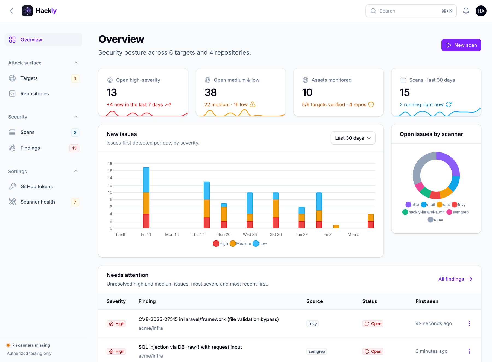
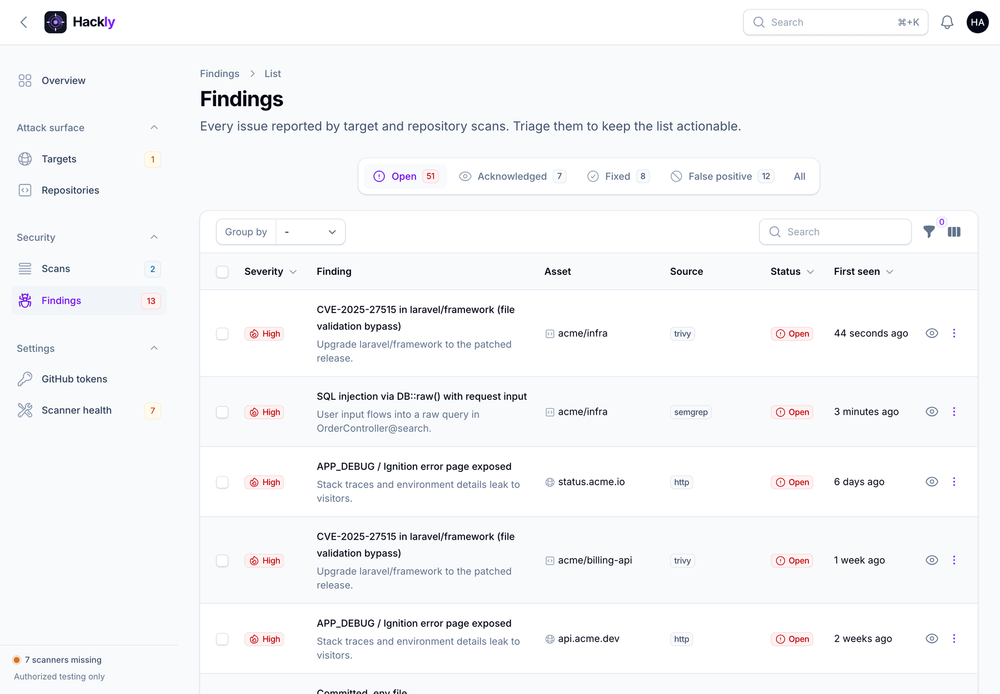
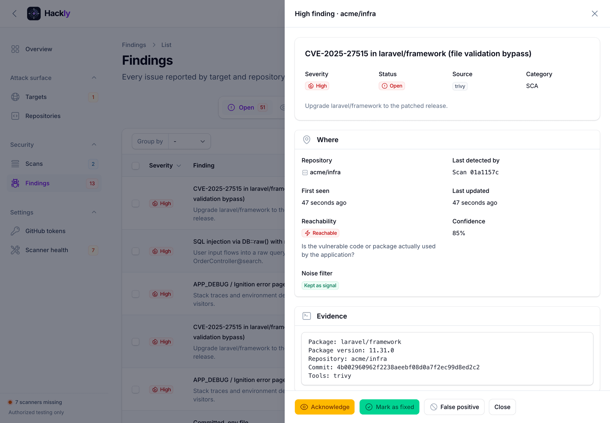
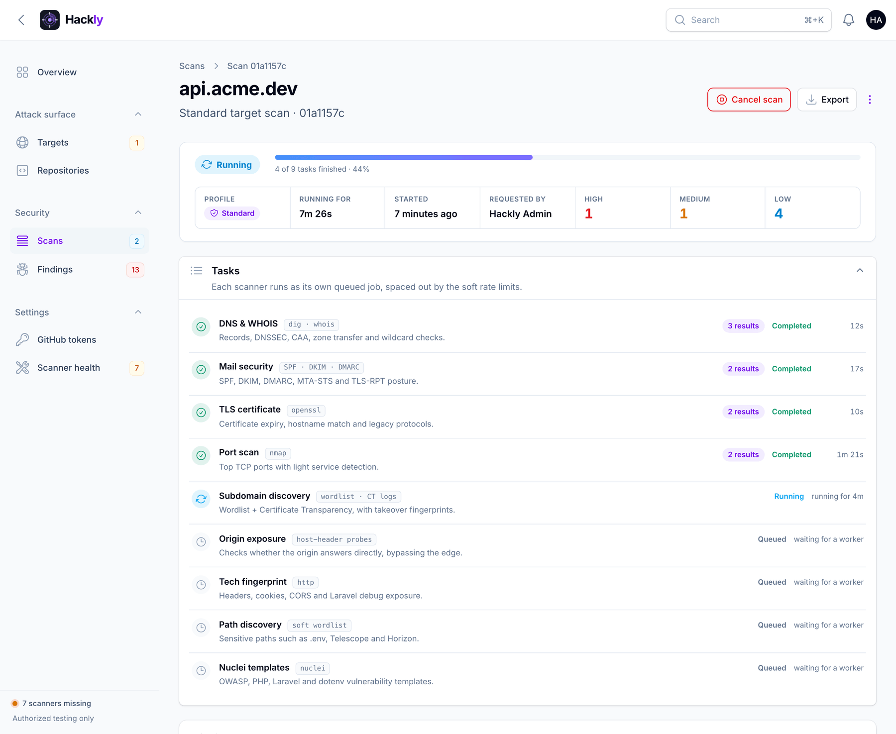
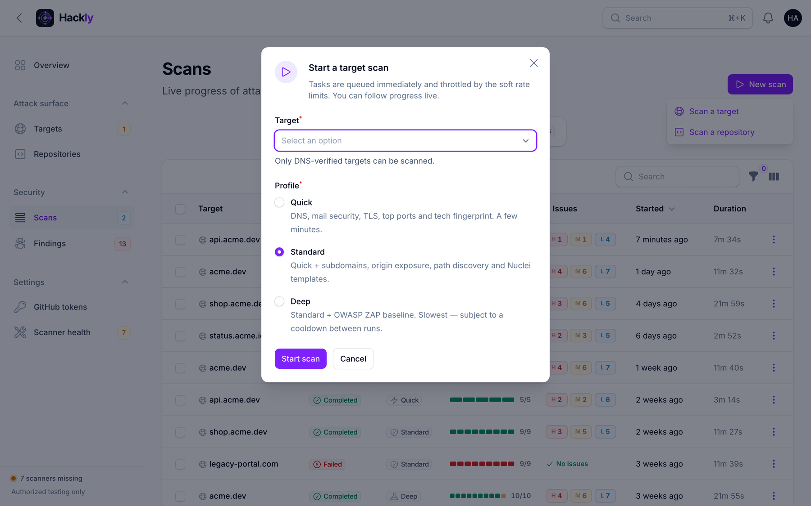
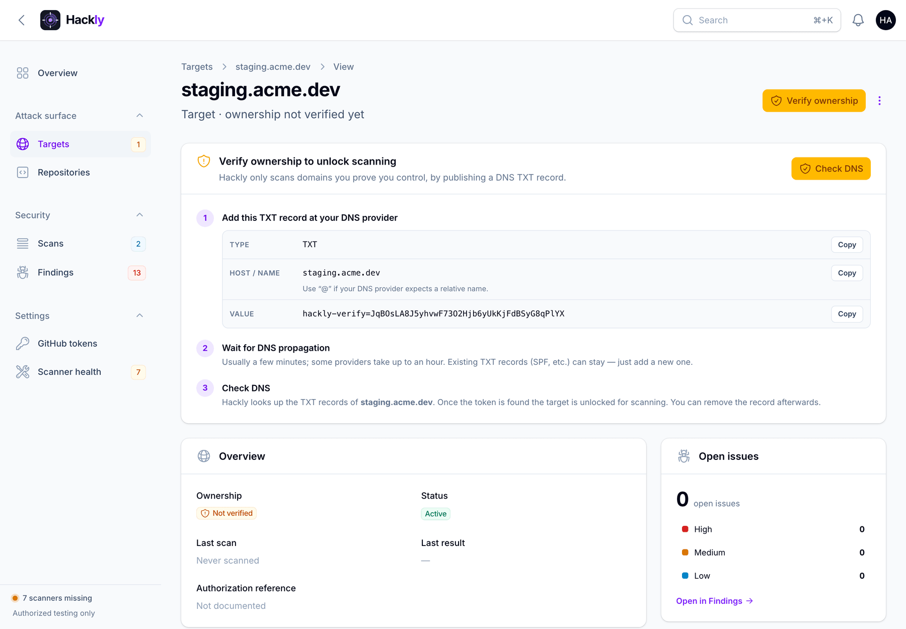
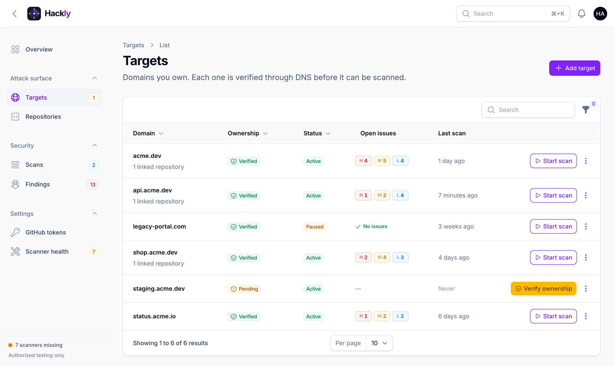
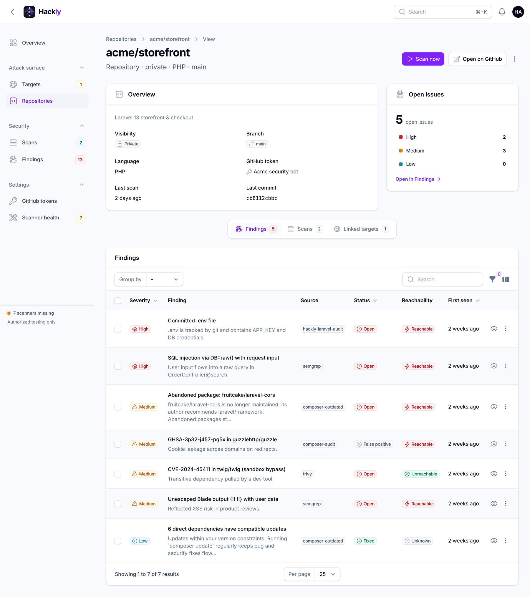
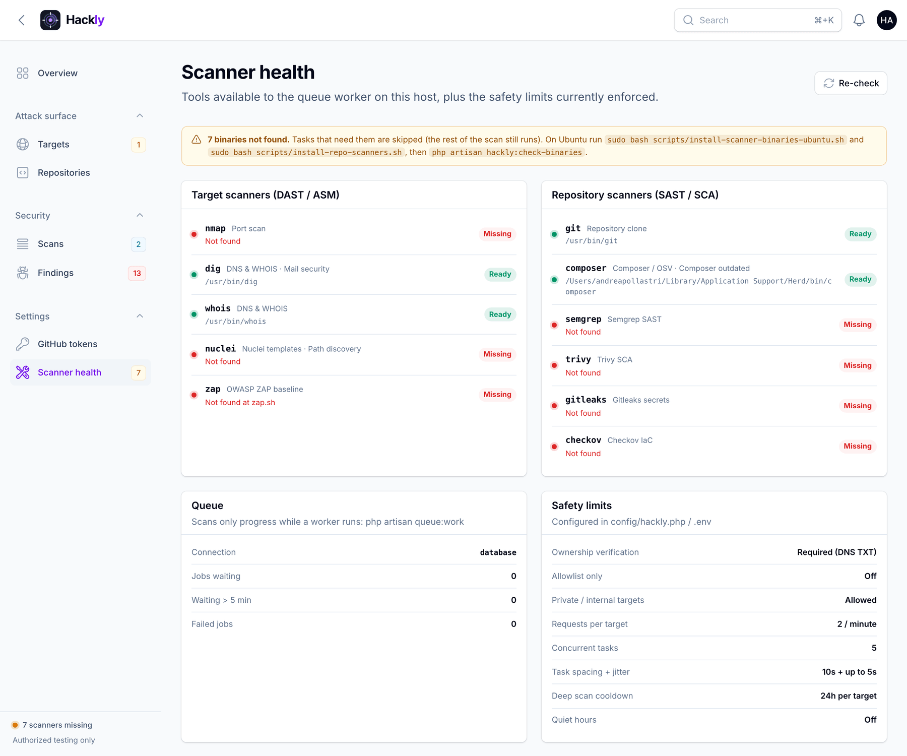
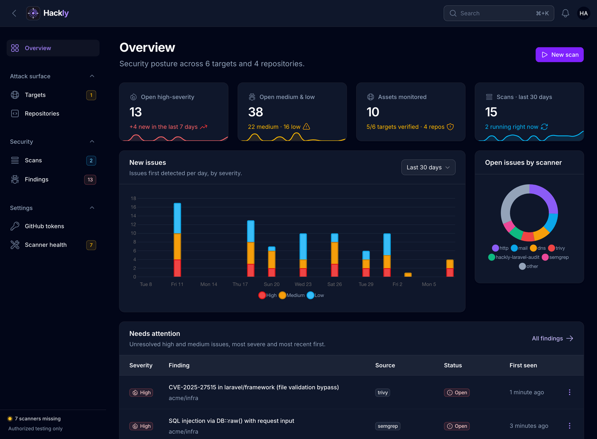

<p align="center">
  
</p>

<h1 align="center">Hackly</h1>

<p align="center">
  <strong>Self-hosted attack-surface &amp; application security scanning — built for Laravel teams.</strong><br>
  Prove you own it, scan it, triage what matters. Domains and GitHub repositories in one calm dashboard.
</p>

<p align="center">
  
  
  
  
</p>

<p align="center">
  <a href="#quick-start">Quick start</a> ·
  <a href="#feature-tour">Feature tour</a> ·
  <a href="#what-it-scans">What it scans</a> ·
  <a href="#api">API</a> ·
  <a href="#configuration">Configuration</a> ·
  <a href="#security-model">Security model</a>
</p>

<p align="center">
  
</p>

> [!IMPORTANT]
> **Only scan targets and repositories you are authorized to assess.** Unauthorized scanning may be illegal. Hackly enforces DNS ownership verification before any target scan can start.

---

## Why Hackly

- **Ownership first.** Every domain is verified with a DNS TXT record before a single packet is sent. No verification, no scan.
- **One place for DAST and SAST.** Attack-surface scans for your domains and SAST / SCA / secrets scans for your GitHub repositories — linked together when they belong to the same app.
- **Findings you can act on.** Severity-ranked, deduplicated, with reachability for PHP code. Acknowledge, fix or dismiss them — decisions survive the next scan.
- **Gentle by default.** Soft rate limits, jitter, task spacing, quiet hours and a deep-scan cooldown keep you off WAF ban lists.
- **Open-source tools, orchestrated.** `nmap`, `nuclei`, OWASP ZAP, Nikto, WPScan, Semgrep, Trivy, Gitleaks, Checkov, `composer audit` / `outdated` and OSV — Hackly runs them, normalizes the output and keeps the history.
- **Evidence, not a certificate.** Compliance packs (DORA, SOC 2, NIS2, ISO 27001 and others) are scored from scans you already ran, for the whole workspace or for one target, one repository, or a linked pair.
- **Self-hosted.** Your targets, tokens and findings never leave your server. GitHub tokens are encrypted at rest.

---

## Feature tour

### Triage findings, not noise

Every issue from every scanner lands in one list, ranked High → Low. Work through the **Open** tab, then acknowledge, mark as fixed, or flag a false positive — a false positive requires a note. Copy any finding as Markdown or as a prompt for an AI, or publish an optional public link. Passed checks are hidden unless you ask for them.

<p align="center"></p>

Open any finding in a slide-over to see where it lives, which scan last detected it, CVE links, PHP reachability and the raw evidence — and triage it without leaving the list.

<p align="center"></p>

### Watch scans run live

Each scanner runs as its own queued job. The scan page shows progress, duration and results per task as they happen — and tells you when a task was skipped because a tool is missing, or when no queue worker is picking up jobs. Cancel a scan, run it again, or export a **PDF / Markdown** report.

<p align="center"></p>

### Start scans from anywhere

Pick a target or a repository, choose a profile — every profile explains what it runs — and optionally include linked assets.

<p align="center"></p>

### Ownership verification, guided

Add a domain and Hackly shows exactly which TXT record to publish, with copy buttons. Reopening the dialog never invalidates a record you already published.

<p align="center"></p>

### Every asset at a glance

Targets and repositories show open issues by severity, last scan and ownership status. Each one has its own page with findings, scan history and linked assets.

<p align="center"></p>

<p align="center"></p>

### Know your scanner coverage

**Scanner health** lists which binaries the worker can actually run, what each one powers, the state of the queue and every safety limit in force.

<p align="center"></p>

### Link the domain to the code

On a target, open **Linked repositories**. On a repository, open **Linked targets**. The same link is on a penetration test, under **Linked repositories**.

Once they are linked, Hackly treats them as one application:

- A target scan offers **Also scan linked repositories**, and turns it on for you.
- A repository scan offers **Also deep-scan linked targets**, and turns it on when the target is already verified.
- A penetration test always queues a deep scan of each linked repository.
- After a repository scan, Hackly remembers the application's own routes (Laravel `routes/*.php`, Next.js `app/` pages, and `pages/`). The next DAST and the next penetration test request those paths on the authorized host. A normal page is not a finding. A sensitive path such as `/.env` or Telescope is.

Compliance uses the same link. The scope menu shows a target alone, a repository alone, or `shop.example.com + acme/shop` when the two are connected. The score and the PDF / Markdown follow that line.

### Penetration tests

**Attack surface → Penetration tests** is a separate engagement, not another radio button on Start scan.

The target must already pass the standing DNS ownership check. That check is enough: a verified target starts without a second TXT record, so nobody has to publish a new one for the run. A fresh `hackly-pentest=` TXT is only required when the target is not already verified. It is valid for 30 minutes and is consumed when the test starts. The scanner IP is on that screen — and on the ordinary DNS check — so it can be allowlisted.

You can record the stack, a Swagger / OpenAPI URL, login areas, other URLs, ports, notes, and one test account. Hackly uses that account for a single login. It does not guess passwords. The run still covers the whole authorized host: fingerprint, paths, TLS, the declared API and logins, ports, Nuclei (Laravel, PHP, frontends, Apache, Nginx, WordPress and others), WPScan, Nikto, and a longer ZAP pass. If `wpscan` or `nikto` is not installed, that task is skipped and the rest continues. There is a 6-hour cooldown per target.

### Compliance

**Security → Compliance** turns the findings you already have into evidence packs. It is not a certification. Controls Hackly cannot see are marked out of scope.

The score starts at 100 and falls for open issues, acknowledged highs, unverified targets, and a workspace that has assets but no completed scan in 30 days. Packs: DORA, SOC 2, NIS2, ISO/IEC 27001, PCI DSS, GDPR, NIST CSF 2.0, OWASP Top 10, CIS Controls v8, HIPAA, Cyber Essentials, and the Essential Eight. Download each one as PDF or Markdown.

**Scope** defaults to **All**. The other lines are a target, a repository, or the pair when they are linked. Framework ids for the API: `dora`, `soc2`, `nis2`, `iso-27001`, `pci-dss`, `gdpr`, `nist-csf`, `owasp-top-10`, `cis-v8`, `hipaa`, `cyber-essentials`, `essential-eight`.

### And the rest

- **Dark mode** that is actually designed, not inverted.
- **In-app notifications** when a scan you started finishes, with a one-line severity summary.
- **Global search** (<kbd>⌘</kbd> / <kbd>Ctrl</kbd> + <kbd>K</kbd>) across targets, repositories and findings.
- **Two-factor authentication** with authenticator apps (with recovery codes) or email codes.
- **Getting-started checklist** on the dashboard until your first target and repository are scanned.

<p align="center"></p>

---

## Quick start

```bash
git clone https://github.com/andreapollastri/hackly.git && cd hackly
composer install
cp .env.example .env
php artisan key:generate
touch database/database.sqlite
php artisan migrate --seed
```

Want to look around before scanning anything? Load a fictional demo workspace (targets, repositories, scans and findings — nothing touches the network):

```bash
php artisan db:seed --class=DemoSeeder
```

Run the app and a queue worker:

```bash
composer run dev            # serve + queue + logs + vite, all at once
```

or separately:

```bash
php artisan serve
php artisan queue:work      # required — scans only progress while a worker runs
php artisan schedule:work   # hourly cleanup, Sunday digest, daily tool databases
```

Sign in at `/` with:

| Email | Password |
|-------|----------|
| `admin@hackly.test` | `password` |

> Change the seeded password immediately (user menu → **Profile**) and enable two-factor authentication.

No Node build is needed: Filament ships its compiled assets and Hackly's panel styles are plain CSS in [`public/css/hackly.css`](public/css/hackly.css).

---

## What it scans

### Target scanners (DAST / attack surface)

| Task | Tool | Profiles |
|------|------|----------|
| DNS & WHOIS | `dig`, `whois` (+ DNSSEC, CAA, AXFR, wildcard) | quick · standard · deep |
| Mail security | SPF / DKIM / DMARC / MTA-STS / TLS-RPT | quick · standard · deep |
| TLS certificate | expiry, hostname, legacy protocols | quick · standard · deep |
| Port scan | `nmap` | quick · standard · deep |
| Tech fingerprint | headers, cookies, CORS, `APP_DEBUG` | quick · standard · deep |
| Subdomain discovery | wordlist + CT logs + takeover fingerprints | standard · deep |
| Origin exposure | direct-IP Host-header probes | standard · deep |
| Path discovery | soft wordlist / Nuclei, plus routes learned from linked repositories | standard · deep |
| Nuclei templates | `nuclei` (+ laravel/php/dotenv tags) | standard · deep |
| OWASP ZAP baseline | ZAP (calibrated severities) | deep |
| Penetration test | Fresh DNS check, then the whole host: Nuclei, ZAP, Nikto, WPScan, scoped ports, declared API and logins, plus linked repositories and the routes learned from them | engagement |

### Repository scanners (Laravel / PHP)

| Task | Tool | Profiles |
|------|------|----------|
| Secrets | `gitleaks` | quick · standard · deep |
| Composer / CVE | `composer audit` + [OSV](https://osv.dev) | quick · standard · deep |
| Dependency health | `composer outdated --locked` — abandoned packages, direct deps a major behind, Laravel out of security support | standard · deep |
| Laravel PHP audit | Hackly static checks on the clone | quick · standard · deep |
| Checkpoint | All [30 Checkpoint checks](https://checkpoint.web.ap.it/) (CVEs, secrets, injection, Laravel config, supply chain) | quick · standard · deep |
| SAST | `semgrep` (`p/php`) | standard · deep |
| SCA | `trivy` | standard · deep |
| IaC | `checkov` (when Docker / Terraform / Actions are present) | deep |
| Laravel live pentest | live probes on **linked** targets | standard · deep\* |

\* Only when the scan is started with **Also deep-scan linked targets**.

**Post-processing of repository findings**

- Cross-tool **deduplication** (the same `package + CVE` from Trivy and OSV becomes one finding)
- **PHP reachability**: namespace usage in `app/`, `routes/`, `config/`…; `require-dev` → unreachable; Laravel package auto-discovery
- **Noise filters**: placeholder secrets, paths outside the app, configurable rule suppressions
- **Dependency health** stays quiet on purpose: compatible (minor / patch) updates are rolled into a single Low finding instead of one row per package
- Findings keep `reachability`, `confidence`, `noise_filtered` and the list of tools that reported them

### Finding lifecycle

| Status | Meaning |
|--------|---------|
| **Open** | Reported by the latest scan and not triaged yet |
| **Acknowledged** | Someone owns it; it stays visible in “Needs attention” |
| **Fixed** | Marked fixed by you — target findings are also closed automatically when a later scan of the same checks no longer reports them |
| **False positive** | Dismissed with a required note. Re-detection keeps the dismissal and the note |

A finding marked *Fixed* that shows up again is reopened automatically, so regressions surface on their own.

---

## How it works

```
Target (DNS-verified)                 Repository (GitHub token)
   │                                      │
   ├──── link (target, repo, or pentest) ─┤
   │                                      │
   ├─ Scan (DAST)                         ├─ Repository scan
   │    routes from the last repo scan    │    remembers routes for the next DAST
   ├─ Penetration test                    │
   │    standing DNS + deep repo scan     │
   └─ Compliance: All, or this subject    └─ same compliance line when linked
```

| Mode | Behaviour |
|------|-----------|
| Target only | DAST profile quick / standard / deep — no repository work |
| Target + repositories | Target DAST **and** a scan of every linked repository. Offered on by default when a repository is linked |
| Repository only | Clone + SAST / SCA / secrets / … — no DAST, no live pentest |
| Repository + targets | Repository scan **and** a deep DAST scan of every linked, verified target. Offered on by default |
| Penetration test | The target's standing DNS verification, then the whole host, plus a deep scan of each linked repository. Not a normal scan profile |

Jobs run on the **database queue** (no Horizon needed). A queue worker must be running for scans to make progress — the scan page warns you when nothing has picked up a task.

---

## Requirements

- PHP **8.3+** and Composer
- SQLite *(default)*, MySQL or PostgreSQL
- `git` for repository clones and [updates](#updates)
- Node.js — optional, only for the Vite dev server

### Target scanner binaries *(recommended)*

| Binary | Used for |
|--------|----------|
| `dig`, `whois` | DNS & WHOIS, mail security |
| `nmap` | Port scan |
| `nuclei` | Nuclei templates, path discovery, penetration-test templates |
| `nikto` | Web server checks during a penetration test. Skipped if missing |
| `wpscan` | WordPress version, plugins, themes and known vulnerabilities. No password guessing. Skipped if missing |
| OWASP ZAP (`zap.sh`) | Deep DAST baseline, and a longer pass during a penetration test |

```bash
sudo bash scripts/install-scanner-binaries-ubuntu.sh
```

### Repository scanner binaries

| Binary | Used for |
|--------|----------|
| `semgrep` | PHP SAST |
| `trivy` | SCA |
| `gitleaks` | Secrets |
| `checkov` | IaC |
| `composer` | `composer audit`, `composer outdated` |

```bash
sudo bash scripts/install-repo-scanners.sh   # Ubuntu 24.04 / 26.x, non-interactive
php artisan hackly:check-binaries
```

Missing binaries make the tasks that need them **skip** — the rest of the scan still runs. **Settings → Scanner health** shows what is available on the worker host and how to fix what is not.

---

## Usage

### Targets

1. **Targets → Add target** — enter a domain (pasting a URL is fine, it is normalized).
2. Publish the TXT record shown on the target page at your DNS provider.
3. **Check DNS** — once the token is found, the target is unlocked.
4. **Start scan** — pick *Quick*, *Standard* or *Deep*. **Also scan linked repositories** is on when a repository is already linked.
5. Follow the scan live, then triage its findings or export a PDF / Markdown report.
6. **Penetration tests** is separate: declare scope, then start it. A target that is already DNS-verified does not need another TXT. The scanner IP on the DNS screen is the address to allowlist.

### GitHub repositories

1. **Settings → GitHub tokens → Add token** (or create one inline while adding a repository).
2. **Repositories → Add repository** — `owner/repo` or a `github.com` URL; metadata is fetched from GitHub.
3. Link the targets where the code is deployed. That same link is what compliance shows as one line, and what a penetration test scans together with the host.
4. **Scan now** — pick a profile. **Also deep-scan linked targets** is on when a linked target is already verified.

#### GitHub token permissions

| Token type | Permissions |
|------------|-------------|
| **Fine-grained** *(recommended)* | Only the repositories you scan · **Contents: Read** · **Metadata: Read** |
| Classic | `repo` for private repositories, `public_repo` for public ones |

### Scans from the CLI

Scans are always started on demand — there is no automatic recurring scan schedule.

| Goal | UI | CLI |
|------|----|-----|
| Target only | Start scan | `php artisan hackly:scan example.com --profile=standard` |
| Target + linked repositories | Start scan → *Also scan linked repositories* (on when linked) | `php artisan hackly:scan example.com --include-repos` |
| Repository only | Scan now | `php artisan hackly:repo-scan owner/repo` |
| Repository + linked targets | Scan now → *Also deep-scan linked targets* (on when a target is verified) | `php artisan hackly:repo-scan owner/repo --include-targets` |
| Penetration test | Penetration tests → Start, when the target is already verified | API `POST /api/v1/penetration-tests/{id}/run` |
| Compliance pack | Compliance → scope → PDF or Markdown | `GET /api/v1/compliance/{framework}/report/pdf` |

### Commands

| Command | Purpose |
|---------|---------|
| `hackly:check-binaries` | Verify scanner binaries (target + repository tools) |
| `hackly:scan {target} --profile=standard` | Target scan; optional `--include-repos` |
| `hackly:repo-scan {owner/repo} --profile=standard` | Repository scan; optional `--include-targets` |
| `hackly:cleanup-outputs` | Delete old raw scanner output |
| `hackly:dispatch-due` | Re-dispatch leftover pending tasks |
| `hackly:token {email}` | Issue a personal API token (`--ability=full`, `read`, or `write`). Shown once |
| `hackly:digest` | Email the weekly findings digest (`--dry-run` prints it). Scheduled Sunday 08:00 |
| `hackly:update-databases` | Refresh Nuclei templates, the Trivy vulnerability database, and Semgrep rules. Scheduled daily at 03:30 |
| `app:update` | Self-update: `status`, `check`, `apply [--force]`, `channel stable\|beta`, `auto on\|off`. See [Updates](#updates) |
| `queue:work` | Process scan jobs |
| `schedule:work` / cron `schedule:run` | Hourly output cleanup, Sunday digest, daily scanner-database refresh, updates |

---

## Configuration

Primary config: [`config/hackly.php`](config/hackly.php), overridable from `.env`. The values in force are visible under **Settings → Scanner health**.

```env
QUEUE_CONNECTION=database
CACHE_STORE=database

# Safety
HACKLY_ALLOWLIST_ONLY=false
HACKLY_ALLOWLIST=example.com,203.0.113.10
HACKLY_ALLOW_PRIVATE_TARGETS=true

# Soft rate limits
HACKLY_PER_TARGET_PER_MINUTE=2
HACKLY_GLOBAL_CONCURRENT=5
HACKLY_JITTER_SECONDS=5
HACKLY_TASK_SPACING_SECONDS=10
HACKLY_DEEP_COOLDOWN_HOURS=24
HACKLY_QUIET_HOURS_ENABLED=false

# Job timeout must exceed the longest scanner (ZAP ~900s)
HACKLY_JOB_TIMEOUT=960
DB_QUEUE_RETRY_AFTER=1020

# Binary paths (examples)
HACKLY_NMAP=nmap
HACKLY_NUCLEI=nuclei
# Writable HOME for nuclei when the queue user cannot write the app directory:
# HACKLY_NUCLEI_HOME=/path/to/storage/app/nuclei-home
# macOS:
# HACKLY_ZAP=/Applications/ZAP.app/Contents/Java/zap.sh
HACKLY_ZAP=zap.sh
HACKLY_NIKTO=nikto
HACKLY_WPSCAN=wpscan
# HACKLY_WPSCAN_API_TOKEN=
# Leave empty to detect the scanner address once. Shown on DNS setup.
# HACKLY_EGRESS_IP=
# HACKLY_PENTEST_AUTH_MINUTES=30
# HACKLY_PENTEST_COOLDOWN_HOURS=6

# GitHub repository scanning
HACKLY_GIT=git
HACKLY_COMPOSER=composer
HACKLY_SEMGREP=semgrep
HACKLY_TRIVY=trivy
HACKLY_GITLEAKS=gitleaks
HACKLY_CHECKOV=checkov
# HACKLY_SEMGREP_CONFIG=p/php
# HACKLY_OSV_ENABLED=true
# HACKLY_REPO_HIDE_UNREACHABLE=false
# HACKLY_REPO_DROP_NOISE=false

# Sunday digest. Requires the scheduler.
HACKLY_DIGEST_ENABLED=true
HACKLY_DIGEST_TIME=08:00
# HACKLY_DIGEST_TIMEZONE=Europe/Rome
# Daily Nuclei / Trivy / Semgrep data refresh
HACKLY_DB_UPDATE_ENABLED=true
HACKLY_DB_UPDATE_TIME=03:30
# SANCTUM_TOKEN_PREFIX=hk_
```

### Production checklist

- `HACKLY_ALLOW_PRIVATE_TARGETS=false`
- Prefer `HACKLY_ALLOWLIST_ONLY=true` with an explicit allowlist
- Configure real mail (`MAIL_MAILER=…`) for email two-factor codes
- Change the seeded admin password and enable two-factor authentication
- Add GitHub tokens only through **Settings → GitHub tokens** (encrypted with `APP_KEY`)
- Set `HACKLY_EGRESS_IP` to the address that should be allowlisted
- Run both install scripts on the worker host, then check **Scanner health** (include `nikto` and `wpscan` if you run penetration tests)
- Keep a supervised `queue:work` process running
- Keep the scheduler running so Sunday's digest, the daily Nuclei / Trivy / Semgrep refresh and [updates](#updates) actually fire

---

## API

Tokens are created on **Profile** (or with `php artisan hackly:token`). Each user owns their own tokens; the workspace stays shared. Send `Authorization: Bearer hk_…`.

| Ability | Can |
|---------|-----|
| `*` | Everything, including creating and revoking tokens |
| `write` | Change targets, scans, findings, credentials. Also reads |
| `read` | GET only |

Interactive docs: `/api/docs` on a running app, or [`docs/api.html`](docs/api.html). The spec is [`docs/openapi.yaml`](docs/openapi.yaml).

Marking a finding `false_positive` requires `note` (at least 8 characters). `POST /api/v1/findings/{id}/share` publishes `/f/{40-character hash}`. `GET /api/v1/findings/{id}/markdown` and `/prompt` return the clipboard text. `GET /api/v1/digest` is the Sunday snapshot as JSON.

`GET /api/v1/compliance` and `GET /api/v1/posture` accept `subject`. Omit it for the whole workspace. Otherwise use `target:{uuid}`, `repository:{uuid}`, or `pair:{targetUuid}:{repositoryUuid}` when those two are linked. The same parameter is on the PDF and Markdown report routes.

Penetration tests: `POST /api/v1/penetration-tests` (optional `repository_ids` links that code to the target), then `POST …/run` when the target is already DNS-verified. `POST …/authorization` and `POST …/authorization/check` are only for a target that has not passed that check. The response includes `scanner_ip` for the allowlist.

## Weekly digest

Sunday at 08:00, every user gets an email of the last seven days: posture, open findings, what arrived, what was triaged (false-positive notes included), failed scans, and situations such as unverified or stale targets. A short copy also lands in the panel notification bell. `php artisan schedule:work` (or cron `schedule:run`) has to be running. `php artisan hackly:digest --dry-run` prints the message without sending it.

## Updates

Hackly keeps itself on the newest build of its channel. The installed release is in [`VERSION`](VERSION). **Settings → Updates** shows it with its build, the newest one, and the last run with its log. Hackly has no roles: every user who can sign in is an administrator, and can update it.

| Channel | Installs |
|---------|----------|
| **Stable** *(default)* | Release tags (`1.2.3` or `v1.2.3`), nothing in between |
| **Beta** | Every new commit on `main`, before it becomes a release |

An update never goes backwards: a build is installed only when it contains the installed commit. Back on stable after beta, Hackly keeps its `main` build until a release contains it. **Force update** reinstalls the newest build of the channel, or installs it when its history differs. It never installs an older one.

Each update backs up the database (SQLite, MySQL, MariaDB or PostgreSQL), installs the build, runs `composer install --no-dev`, migrates, rebuilds the caches, restarts the queue workers and checks that the app boots. If a step fails, the previous code and the database come back. The last five backups are kept in `storage/app/updates/backups`, the full log in `storage/app/updates/update.log`.

**Update to …** and **Force update** start within a minute. With automatic updates on, the nightly run is at `APP_UPDATE_TIME` (04:00). Both start from the scheduler, so it must be running:

```cron
* * * * * php artisan schedule:run
```

When it has not run in the last few minutes, the Updates page says so.

Two kinds of install update themselves:

- **A git checkout** (`git clone`): the build is checked out in place (detached), in maintenance mode while it is built and migrated. Tracked files changed by hand stop the update. Force update discards them.
- **A release of a deploy** (`releases/`, `current`, `shared/`, as Cipi and Deployer make them): the build goes into `releases/<build>` next to the running one and shares its `.env` and `storage`. `current` points at it once it is migrated, and Cipi's workers restart on it. Of the releases it made, Hackly keeps the live one, the previous one and one more.

Anything else shows a notice on the page. Update it the way it was installed.

An installation from before 1.0.0 has no updater yet: update it by hand one last time (`git pull`, `composer install --no-dev`, `php artisan migrate --force`, or a redeploy) and add the scheduler. From then on it updates itself.

Updates need `git` and `composer` (and the database client for the backup: `mysqldump`/`mysql` or `pg_dump`/`psql`) on the `PATH` of the user that runs the scheduler. No Node build: the panel runs on Filament's compiled assets.

```env
APP_UPDATES=true                 # default: on when APP_ENV=production
APP_UPDATE_REPOSITORY=https://github.com/andreapollastri/hackly.git
APP_UPDATE_CHANNEL=stable        # stable or beta, until changed on the Updates page
APP_UPDATE_AUTO=true             # nightly update, until changed on the Updates page
APP_UPDATE_TIME=04:00            # in the application timezone
APP_UPDATE_BACKUP=true           # database backup before every update
APP_UPDATE_ASSETS=false          # no npm build: Filament ships compiled assets
# Empty: found on the PATH (PHP: the one running the update)
# APP_UPDATE_PHP=/usr/bin/php8.4
# APP_UPDATE_COMPOSER=/usr/local/bin/composer
# APP_UPDATE_GIT=git
```

From the CLI:

| Command | Purpose |
|---------|---------|
| `php artisan app:update status` | Channel, installed and newest builds, last run |
| `php artisan app:update check` | Look for a newer build now |
| `php artisan app:update apply [--force]` | Update now. `--auto` is the nightly run: it does nothing while automatic updates are off |
| `php artisan app:update channel stable\|beta` | Switch channel |
| `php artisan app:update auto on\|off` | Turn the nightly update on or off |

## Security model

- **Target** scans require DNS TXT **ownership verification**. The scanner IP is shown there so it can be allowlisted
- **Penetration tests** use that same standing check. A second TXT is required only when the target is not already verified. That extra token expires after 30 minutes and is consumed on start
- **Repository** scans require a GitHub token with read access to that repository
- Linking targets ↔ repositories is optional. When you do link them, DAST, penetration tests and compliance use that pair
- Optional **allowlist** and private / internal IP blocking for targets
- Soft **rate limits**, **jitter**, **task spacing**, **quiet hours** and a **deep-scan cooldown**
- Admin accounts support **TOTP** (with recovery codes) and **email** two-factor authentication
- Repository clones are deleted after each scan when `HACKLY_REPO_CLEANUP=true` (default)

Hackly is an orchestration layer — it does not replace responsible disclosure policies or scoped pentest agreements. PHP reachability analysis is heuristic (a strong signal for Laravel apps), not an interprocedural guarantee.

---

## Development

```bash
php artisan test                         # feature + unit tests (renders every panel page)
php artisan db:seed --class=DemoSeeder   # fictional demo workspace
./vendor/bin/pint                        # code style
```

The screenshots in this README are taken from the demo workspace. All names, domains and findings in it are fictional.

## License

MIT
